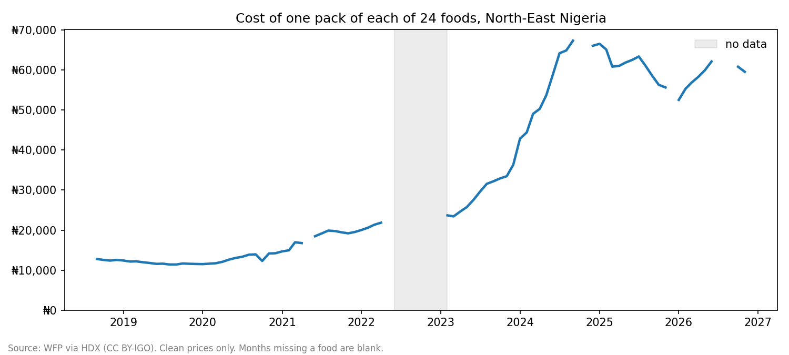
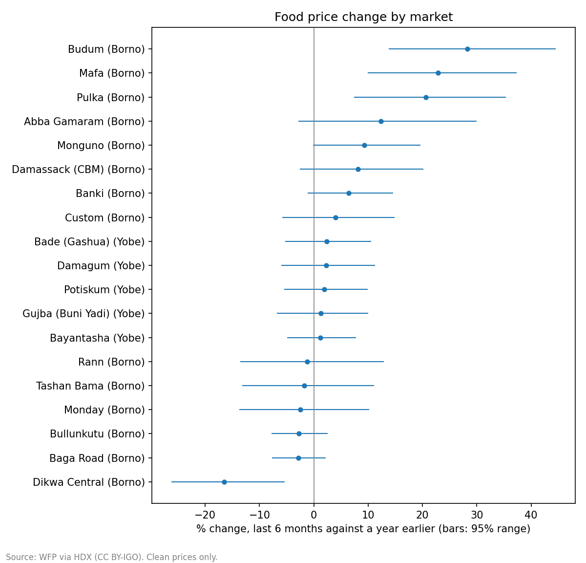

# Findings

_Generated by `pipeline/questions.py`. Source: WFP via HDX (CC BY-IGO). Clean prices only. North-East means Borno, Yobe and Adamawa (Adamawa until November 2025)._

## 1. What does a basket of food cost?

One pack of each of 24 foods cost about **₦12,123** in the year from September 2018 and **₦59,503** in November 2026: **4.9 times** as much. A year earlier it was ₦55,602 (+7.0%). The highest month was September 2024 (₦67,280).

Largest parts of the latest cost: Meat (goat) ₦6,682 (KG), Eggs ₦6,347 (30 pcs), Meat (beef) ₦5,726 (KG), Milk (powder) ₦4,200 (400 G), Rice (imported) ₦3,962 (2.8 KG), Groundnuts ₦3,525 (2.2 KG).

The price index, where every food counts equally, gives 4.5 times and +8.6% over the year. The naira basket gives dearer packs more weight, so the two differ.

## 2. Which foods and places rose fastest?

**Foods, since the year from September 2018:** Oil (vegetable) 6.8x, Fish 6.3x, Eggs 6.1x, Oil (palm) 5.6x, Maize flour 5.5x.
**Foods, last 12 months:** Onions +41.9%, Beans (red) +41.8%, Fish +32.5%, Beans (white) +31.3%; falling most: Yam -19.1%, Watermelons -15.5%, Meat (beef) -5.8%.
**States, since the year from September 2018:** Borno 4.3x, Yobe 4.7x.

**Markets, last year.** 19 markets have enough matching prices. For 4 of them the direction is clear (the 95% range leaves out zero). Ranges overlap, so close ranks should not be read as real differences.

| market            | state   |   foods | change   | range        |
|:------------------|:--------|--------:|:---------|:-------------|
| Budum             | Borno   |      22 | +28.2%   | +14% to +45% |
| Mafa              | Borno   |      23 | +22.9%   | +10% to +37% |
| Pulka             | Borno   |      24 | +20.6%   | +7% to +35%  |
| Abba Gamaram      | Borno   |      20 | +12.4%   | -3% to +30%  |
| Monguno           | Borno   |      23 | +9.3%    | -0% to +20%  |
| Damassack (CBM)   | Borno   |      22 | +8.2%    | -3% to +20%  |
| Banki             | Borno   |      22 | +6.4%    | -1% to +15%  |
| Custom            | Borno   |      22 | +4.0%    | -6% to +15%  |
| Bade (Gashua)     | Yobe    |      23 | +2.4%    | -5% to +11%  |
| Damagum           | Yobe    |      23 | +2.3%    | -6% to +11%  |
| Potiskum          | Yobe    |      23 | +2.0%    | -5% to +10%  |
| Gujba (Buni Yadi) | Yobe    |      24 | +1.3%    | -7% to +10%  |
| Bayantasha        | Yobe    |      24 | +1.2%    | -5% to +8%   |
| Rann              | Borno   |      15 | -1.2%    | -14% to +13% |
| Tashan Bama       | Borno   |      22 | -1.8%    | -13% to +11% |
| Monday            | Borno   |      23 | -2.5%    | -14% to +10% |
| Bullunkutu        | Borno   |      23 | -2.8%    | -8% to +3%   |
| Baga Road         | Borno   |      23 | -2.9%    | -8% to +2%   |
| Dikwa Central     | Borno   |      20 | -16.5%   | -26% to -5%  |

## 3. Which price moves were unusual?

Largest 3-month moves of the basket:

| from    | to      | change   |   foods compared |   moved that way | largest movers                                                   |
|:--------|:--------|:---------|-----------------:|-----------------:|:-----------------------------------------------------------------|
| 2023-12 | 2024-03 | +30.7%   |               24 |               22 | Beans (red) +66%, Beans (white) +64%, Millet +61%, Sorghum +59%  |
| 2024-04 | 2024-07 | +28.6%   |               24 |               23 | Fish +90%, Tomatoes +66%, Beans (red) +64%, Beans (white) +63%   |
| 2023-05 | 2023-08 | +27.5%   |               24 |               23 | Yam +95%, Maize flour +86%, Sorghum +70%, Tomatoes +64%          |
| 2025-07 | 2025-10 | -13.1%   |               24 |               19 | Tomatoes -31%, Sorghum -30%, Onions -28%, Millet -27%            |
| 2025-01 | 2025-04 | -12.2%   |               24 |               22 | Onions -47%, Oranges -30%, Millet -26%, Sorghum -20%             |
| 2019-03 | 2019-06 | -7.9%    |               24 |               19 | Bananas -31%, Oranges -31%, Beans (red) -28%, Beans (white) -25% |

Foods that moved more than 3 times their usual 3-month spread, in both Borno and Yobe (19 episodes, strongest 12 shown):

| commodity       | from    | to      | change   | borno   | yobe    |   times usual spread |
|:----------------|:--------|:--------|:---------|:--------|:--------|---------------------:|
| Sugar           | 2023-12 | 2024-03 | +46.8%   | +57.0%  | +35.5%  |                  6   |
| Salt            | 2025-02 | 2025-05 | +94.4%   | +90.1%  | +108.3% |                  5.6 |
| Oil (vegetable) | 2022-02 | 2022-05 | +47.0%   | +44.9%  | +48.2%  |                  4.6 |
| Milk (powder)   | 2023-10 | 2024-01 | +24.9%   | +31.1%  | +15.8%  |                  4.5 |
| Oil (palm)      | 2022-02 | 2022-05 | +40.2%   | +32.2%  | +48.7%  |                  4.3 |
| Onions          | 2024-08 | 2024-11 | +167.5%  | +239.3% | +64.7%  |                  4.3 |
| Sugar           | 2023-07 | 2023-10 | +32.1%   | +29.0%  | +35.3%  |                  4.3 |
| Oil (palm)      | 2024-10 | 2025-01 | +38.0%   | +42.3%  | +30.5%  |                  4.1 |
| Rice (imported) | 2023-10 | 2024-01 | +41.7%   | +52.2%  | +25.7%  |                  3.9 |
| Maize flour     | 2023-05 | 2023-08 | +86.4%   | +110.4% | +100.2% |                  3.9 |
| Rice (imported) | 2025-07 | 2025-10 | -25.9%   | -16.3%  | -42.2%  |                 -3.8 |
| Yam             | 2023-05 | 2023-08 | +95.1%   | +137.1% | +83.6%  |                  3.7 |

## Limits

- A move seen in two states is more likely real, but this does not prove it or show its cause.
- Screening out suspected prices can also remove or soften real shocks.
- The cost uses recent typical prices carried back with each food's index. It is an illustration, not a household budget.
- The latest month has no later readings to test it against. Details: [indices_summary.md](indices_summary.md), [data_quality.md](data_quality.md).
