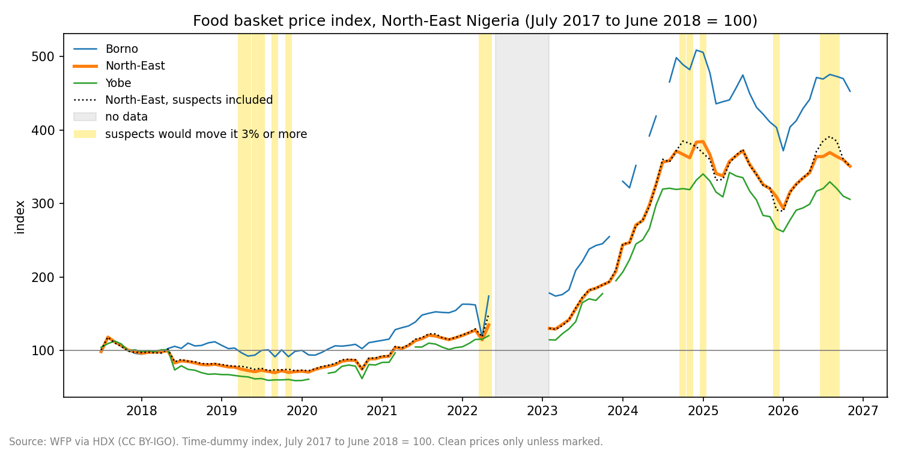

# Price indices: findings

_Generated by `pipeline/report_indices.py`. Source: WFP via HDX (CC BY-IGO). Time-dummy index, July 2017 to June 2018 = 100. Clean prices only unless marked._

## Headline (clean prices only)

- In November 2026 the North-East food basket index was **350.8**: the same foods cost about **3.5 times** what they did in the year from July 2017.
- Over the last 12 months the basket changed by **+9.5%**.
- The fastest annual rise was **+110.3%**, in May 2024.

## By state (latest month with a basket index)

| area       | month   |   index | 12-month change   |   index with suspects | effect of suspects   |
|:-----------|:--------|--------:|:------------------|----------------------:|:---------------------|
| North-East | 2026-11 |   350.8 | +9.5%             |                 350.4 | -0.1%                |
| Borno      | 2026-11 |   452.9 | +10.2%            |                 434   | -4.2%                |
| Yobe       | 2026-11 |   305.7 | +8.4%             |                 307   | +0.4%                |

## Items, North-East, November 2026

| food            |   index | 12-month change   | 12-month change with suspects   | effect of suspects on index   | prices suspected, all months   |
|:----------------|--------:|:------------------|:--------------------------------|:------------------------------|:-------------------------------|
| Beans (red)     |   230.9 | +44.6%            | +44.7%                          | -0.0%                         | 0.0%                           |
| Onions          |   429.6 | +40.5%            | +38.5%                          | -1.5%                         | 2.1%                           |
| Fish            |   802.4 | +34.5%            | +37.1%                          | +7.2%                         | 5.1%                           |
| Beans (white)   |   236.6 | +34.1%            | +34.2%                          | +0.2%                         | 0.0%                           |
| Sorghum         |   227   | +26.2%            | +26.2%                          | -0.0%                         | 0.0%                           |
| Rice (local)    |   293.5 | +22.4%            | +22.4%                          | +0.0%                         | 0.0%                           |
| Millet          |   236.2 | +18.6%            | +18.6%                          | +0.0%                         | 0.0%                           |
| Maize flour     |   350.6 | +17.3%            | +17.3%                          | +0.0%                         | 0.0%                           |
| Oil (vegetable) |   487.4 | +16.5%            | +16.5%                          | +0.0%                         | 0.0%                           |
| Cowpeas         |   302.1 | +13.9%            | +12.2%                          | +0.5%                         | 0.4%                           |
| Oil (palm)      |   418.2 | +12.3%            | +12.3%                          | +0.0%                         | 0.0%                           |
| Eggs            |   612.3 | +7.6%             | +7.4%                           | -0.3%                         | 0.5%                           |
| Milk (powder)   |   429.1 | +7.5%             | +6.3%                           | +1.0%                         | 3.6%                           |
| Meat (goat)     |   497.8 | +6.0%             | -7.0%                           | -11.7%                        | 0.1%                           |
| Sugar           |   357.5 | +4.5%             | +4.4%                           | -0.2%                         | 6.8%                           |
| Groundnuts      |   358.5 | +3.9%             | +3.9%                           | +0.0%                         | 0.0%                           |
| Salt            |    79.9 | -1.8%             | +0.2%                           | +32.3%                        | 2.5%                           |
| Oranges         |   426.5 | -2.1%             | -1.8%                           | +0.6%                         | 1.3%                           |
| Bananas         |   383.4 | -2.2%             | -6.0%                           | -0.3%                         | 3.1%                           |
| Rice (imported) |   286.8 | -2.5%             | -4.0%                           | +0.1%                         | 0.2%                           |
| Tomatoes        |   339.6 | -4.1%             | -4.2%                           | -0.4%                         | 1.8%                           |
| Meat (beef)     |   463.6 | -5.2%             | -5.3%                           | +0.0%                         | 0.1%                           |
| Watermelons     |   314.4 | -15.2%            | -17.5%                          | +1.2%                         | 2.6%                           |
| Yam             |   605.2 | -19.3%            | -19.2%                          | +1.4%                         | 0.7%                           |

## Suspected prices: shown, not counted

2,460 of 52,314 basket prices since July 2017 are suspected (4.7%); 1,818 of them are spinach. They stay in the clean table and are left out of every figure above. Suspected does not mean proven wrong: some may be real.

What putting each group back would do to the North-East basket:

| group                                               |   prices | largest effect   | in      | effect in November 2026   |
|:----------------------------------------------------|---------:|:-----------------|:--------|:--------------------------|
| spinach, not used at all                            |     1818 | +5.0%            | 2019-09 | -1.1%                     |
| far from other markets that month                   |      169 | +5.1%            | 2022-04 | +0.9%                     |
| Yobe, May 2021: other foods' prices                 |       55 | +0.6%            | 2021-05 | -0.1%                     |
| state month that jumps, then comes back             |       79 | +13.8%           | 2022-05 | +0.1%                     |
| state 3x off both before and after (all sugar)      |      113 | +7.3%            | 2024-11 | -0.0%                     |
| market 3x off both before and after                 |       83 | +6.8%            | 2026-07 | -0.0%                     |
| single price 3x off the state both before and after |      143 | -1.4%            | 2023-04 | +0.1%                     |
| **everything suspected**                            |     2460 | +11.2%           | 2022-05 | -0.1%                     |

Months where all suspects together would move it by 3% or more (gold on the chart):

| month   |   clean |   with suspects | effect   | 12-month change, clean   | 12-month change, with suspects   |
|:--------|--------:|----------------:|:---------|:-------------------------|:---------------------------------|
| 2019-04 |    74.4 |            78.3 | +5.2%    | -24.1%                   | -18.9%                           |
| 2019-05 |    72.4 |            76.5 | +5.6%    | -27.2%                   | -24.7%                           |
| 2019-06 |    70.9 |            74.1 | +4.5%    | -14.4%                   | -12.2%                           |
| 2019-07 |    73   |            75.7 | +3.7%    | -14.7%                   | -13.6%                           |
| 2019-09 |    69.6 |            73.4 | +5.4%    | -16.0%                   | -13.2%                           |
| 2019-11 |    69.9 |            74.2 | +6.2%    | -12.8%                   | -8.9%                            |
| 2022-04 |   114.4 |           118.4 | +3.5%    | +11.6%                   | +14.7%                           |
| 2022-05 |   134.6 |           149.7 | +11.2%   | +26.4%                   | +39.2%                           |
| 2024-10 |   367   |           385   | +4.9%    | +94.1%                   | +103.5%                          |
| 2024-11 |   362.3 |           381.9 | +5.4%    | +87.4%                   | +97.3%                           |
| 2025-01 |   384.4 |           368.4 | -4.2%    | +57.6%                   | +50.6%                           |
| 2025-12 |   309.2 |           291.2 | -5.8%    | -19.4%                   | -22.9%                           |
| 2026-07 |   364   |           385.2 | +5.8%    | -2.2%                    | +3.1%                            |
| 2026-08 |   369.4 |           391.4 | +6.0%    | +4.6%                    | +11.1%                           |
| 2026-09 |   364.1 |           385.1 | +5.8%    | +7.2%                    | +13.5%                           |

## How to read this

Details of the gaps and inconsistent prices: [data_quality.md](data_quality.md).

- Each item's index comes from one fit of month and market effects, so markets joining or leaving do not move it. Past values can shift slightly when new months are added.
- The tests compare a price with readings before and after, so the 327 clean prices of November 2026 have not had them, and the months just before have only partly had them. The headline could change slightly as new months arrive.
- Clean means no test raised a doubt; it does not prove a price is right. Early salt prices are uneven.
- Adamawa has no basket index of its own; its markets count in the North-East until November 2025.
- The basket gives each item equal weight; no consumption weights are available for this area. State baskets can hold fewer items than the North-East one (at least 20).
- There are no prices for most items from 2022-06 to 2023-01; that stretch is left blank and shaded.
- Not used: Spinach (the typical price sits near 50 naira for most of 2017 to 2023, and Borno has long gaps and an unexplained 5 to 9x stretch from April to November 2019).
